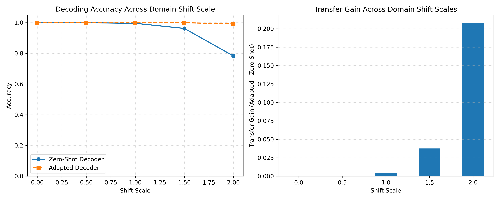

# Cross-Subject Transfer & Adaptation (`neurotwin-06-cross-subject-transfer`)

Evaluate zero-shot source decoding against target-aligned, source-regularized prototype adaptation across domain shift scales in **C++17**.



## Scientific Motivation & Overview

Cross-session and cross-subject neural decoding often suffers from feature rotations, channel gain variations, and baseline offsets that shift class distributions away from a source model. Combining target feature normalization with source-regularized target prototypes preserves accuracy as shift severity grows.

This project implements:

1. A C++17 4-class, 12-dimensional synthetic neural feature simulator (`src/cross_subject_transfer.cpp`) with pairwise planar rotation, channel gain drift, and additive bias scaled by `Shift_Scale`.
2. A comparison between zero-shot nearest-centroid decoding using source centroids (`ZeroShot_Acc`) and a target-aligned decoder using z-score normalization plus a `0.35 / 0.65` source/target centroid blend (`Adapted_Acc`).
3. A sanity verification gate (`tests/verify_gate.py`) and a shift sweep (`scripts/run_shift_sweep.py`) across `Shift_Scale` values from `0.0` to `2.0`.

## Repository Structure

- `src/cross_subject_transfer.cpp`: C++17 data generator, zero-shot and target-aligned nearest-centroid decoders, CLI runner, and CSV exporter.
- `scripts/run_shift_sweep.py`: Compiles `src/cross_subject_transfer.cpp`, sweeps `Shift_Scale` across `[0.0, 0.5, 1.0, 1.5, 2.0]`, saves `results/shift_sweep.csv` and `results/eval_shift1.00.csv`, and generates `figures/main_result.png`.
- `tests/verify_gate.py`: Verification gate confirming C++17 compilation, 240-trial test evaluation CSV output, `[0, 1]` accuracy bounds, and `Transfer_Gain` consistency.
- `results/`: Generated sweep and per-trial evaluation CSV outputs (`shift_sweep.csv`, `eval_shift1.00.csv`).
- `figures/main_result.png`: Two-panel summary figure showing `ZeroShot_Acc` vs. `Adapted_Acc` and `Transfer_Gain` across shift scales.
- `data/.gitkeep`: Placeholder directory for external or benchmark datasets.

## Sweep Results (320 trials, 240 test trials, `noise_std = 0.55`)

| Shift Scale | ZeroShot Acc | Adapted Acc | Transfer Gain |
| :--- | :--- | :--- | :--- |
| `0.0` | `1.0000` | `1.0000` | `+0.0000` |
| `0.5` | `1.0000` | `1.0000` | `+0.0000` |
| `1.0` | `0.9958` | `1.0000` | `+0.0042` |
| `1.5` | `0.9625` | `1.0000` | `+0.0375` |
| `2.0` | `0.7833` | `0.9917` | `+0.2083` |

## Key Findings & Conclusions

- **Zero-shot robustness up to moderate shift:** Zero-shot accuracy remains high through `Shift_Scale = 1.0` (`1.0000` at `0.0` and `0.5`, `0.9958` at `1.0`) and dips slightly to `0.9625` at `1.5`.
- **Sharp divergence under strong shift:** At `Shift_Scale = 2.0`, zero-shot accuracy drops to `0.7833`, while target adaptation holds `0.9917` (`Transfer_Gain = +0.2083`).
- **Ceiling stability:** Adapted accuracy stays at `1.0000` across `0.0`–`1.5` and `0.9917` at `2.0` with a 25% target adaptation split (`80` adaptation trials, `240` test trials).

## Next Steps for Future Researchers & Collaborators

1. **Low-shot adaptation curves:** Vary the target adaptation sample budget (e.g., 1, 5, 10, or 25 trials per class) and source/target regularization weights under higher observation noise.
2. **Full covariance and Riemannian alignment:** Extend feature alignment from diagonal z-scoring to full covariance whitening or Riemannian/Euclidean matrix transport across channels.
3. **Overlap and higher-noise stress tests:** Test closer class centroids or higher `noise_std` regimes where zero-shot accuracy degrades earlier across shift scales.
4. **Cross-subject biosignal benchmarks:** Apply the C++17 alignment pipeline to multi-session or multi-subject EEG, EMG, or neural ensemble recordings.

## How to Run Locally

```bash
python3 tests/verify_gate.py
python3 scripts/run_shift_sweep.py
```
